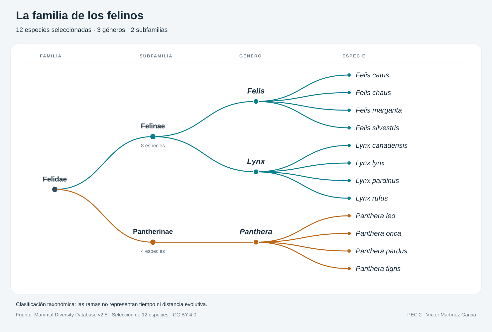

# Clasificación de los felinos

Selección de 12 especies organizadas por familia, subfamilia y género.

Visualización: Víctor Martínez Garcia.

Herramientas: RAWGraphs y acabado del SVG con Python.

Datos: Mammal Diversity Database v2.5, CC BY 4.0.

Fecha de publicación: 30/10/2026
